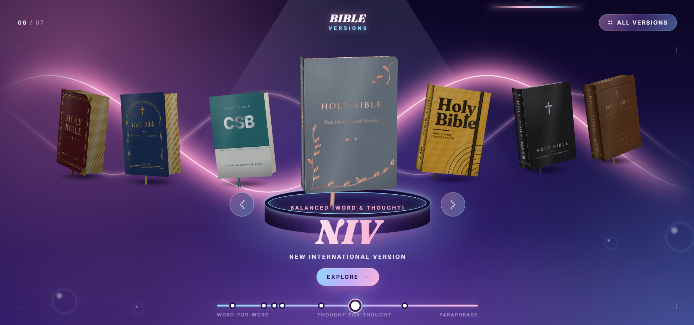
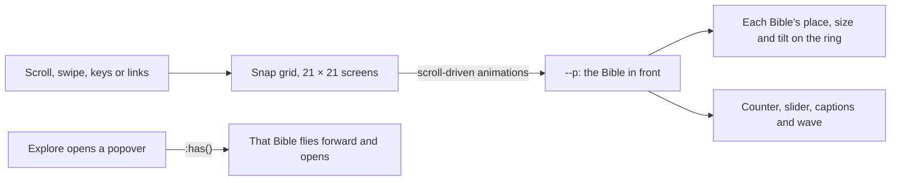

# Bible Versions

A 3D ring of the seven most popular English Bible translations. Scroll or swipe to turn it, then open any Bible to compare its history, strengths and weaknesses. Built with HTML and CSS, plus about 20 lines of JavaScript for one effect.



## Why I built it

Picking a Bible translation is confusing: the same verse reads very differently in the NASB and the NLT, and most comparison charts are walls of text. I wanted something you could browse like a product showcase, so the differences are easy to see at a glance. I also wanted to find out how much of an interactive 3D page I could build with HTML and CSS alone.

## Features

- **Seven translations, seven covers**: NASB, ESV, KJV, NKJV, CSB, NIV and NLT, each with its own cover design, ordered from most literal to easiest to read.
- **Turn the ring any way you like**: scroll or swipe up, down or sideways, use the arrow keys, or click the ‹ › buttons. It wraps round from the NLT back to the NASB.
- **A closer look**: the Bible in front is bigger and turns slightly to follow your mouse.
- **Open a Bible**: Explore swings the cover open to John 3:16 in that translation, beside a see-through panel covering its history, reading level, sources, advantages, disadvantages and who it suits best.
- **See the trade-off**: a slider shows where each translation sits between word-for-word and paraphrase. Click a dot, or use All versions, to jump straight to one.
- **Works on phones**: swipe to turn the ring, and the details open as a bottom sheet.

## Tech stack

| Layer | Choice | Why |
| --- | --- | --- |
| Page | One HTML file, no framework or build step | Opens straight from disk or any static host |
| 3D Bibles | CSS 3D transforms and inline SVG textures | Every cover is drawn in CSS, so there are no image files or WebGL |
| Turning the ring | Scroll-driven animations, scroll snap, `sin()` and `cos()` | The scroll position is the state, so wheels, swipes, keys and links all turn the ring without any scroll-handling JavaScript |
| Page state | Style queries and `:has()` | The counter, slider and opened Bible react straight from CSS |
| Detail panels | Popover API | The browser handles opening, closing, Escape and focus |
| Mouse follow | About 20 lines of JavaScript | CSS can't read the cursor position; everything else works without it |

## How it works

The page is a grid of full-screen cells, 21 screens wide and 21 tall (three laps of the seven Bibles each way), and scroll snap stops on every cell. Two scroll-driven animations turn the scroll position into one number, `--p`, which changes by one for every Bible you scroll past, whichever direction you scroll. Each Bible works out how far it is from the front and places itself on the ring with `sin()` and `cos()`. The counter, slider, captions and pink wave all read the same number.



Browsers without scroll-driven animations get a simpler layout through `@supports`: one Bible per screen down the page, with the same detail panels.

## Getting started

You need a Chromium-based browser (Chrome, Edge, Opera or Brave), version 135 or newer, for the full 3D ring. There's nothing to install or build.

```bash
git clone https://github.com/PaceWalker14/BibleVersions.git
cd BibleVersions
```

Open `index.html` in your browser, or serve the folder and visit http://localhost:8000:

```bash
python -m http.server 8000
```

## Roadmap and known limitations

- The full ring needs Chromium 135 or newer. Firefox gets the one-Bible-per-screen layout, and Safari hasn't been tested.
- A slow, short trackpad swipe springs back to the same Bible. That's how scroll snap works; a normal flick moves on one.
- The translation notes are short summaries for comparison, not scholarship.
- Adding a translation means editing several places (its section, panel, slider dot, menu card, snap grid and cover styles). I'd like to make that a one-place change.
- A live demo link is still to come.

## What I learned

How much modern CSS can do on its own. Scroll-driven animations, trigonometric functions and style queries replaced what would normally be a JavaScript carousel library, and the Popover API gave me accessible panels for free. The hardest part was scrolling in two directions at once: Chrome only snaps to an area that's in view on the other axis too, so every row and column of the grid has to span the whole page. I also learnt to build in layers, so a browser that can't do the 3D ring still gets a working page rather than a broken one.

## Licence

No licence has been chosen yet, so the code is all rights reserved for now. <!-- add a LICENSE file (for example MIT) and update this line -->

The Bible translations and their names belong to their publishers; John 3:16 is quoted from each one for comparison.
